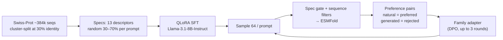

# Aria

_2026-10-23 · written from the paper draft (`research/papers/Aria_ICLR`) · replaces the pre-implementation plan, now in [`archive/aria-original-plan/`](../../archive/aria-original-plan/aria-plan.md)_

**Aria is a framework that customizes a language model to generate biological sequences from a property spec, then improves it with preference tuning against oracles.** Today it is built for proteins. Customers can use public data, their own, or both.

---

## Recipe

| Stage | Detail |
|---|---|
| Data | Reviewed UniProt, 20–512 residues. 348,867 train / 35,115 held-out, no held-out protein >30% identity to training |
| Specs | 13 descriptors in 4 families (sequence properties, developability, structure/topology, function). 3–10 per prompt, mean 6.6 |
| SFT | QLoRA, 4-bit base, rank 32, 2 epochs, 83.9M trainable params, ~35 GPU-hours. No protein-specific pretraining |
| Preference tuning | Sigmoid DPO β=0.5 + preferred-response NLL term, 60 steps/round, 64 samples/prompt, 2 seeds |
| Adherence eval | Recomputed with the same feature code, plus SignalP 6, DeepTMHMM, Pfam via HMMER |

---

## What it shows

| Result | Number |
|---|---|
| Adherence on measurable properties | Improves: length, hydrophobicity, Cys count, TM topology, signal peptides |
| Prompt-mismatch controls | Gains depend on the requested spec |
| Preference tuning, 1st family (uS13, PF00416) | +8.2 mean ESMFold pLDDT |
| Preference tuning, 3 more families | +20.8 to +43.6 pts requested-domain recovery (mean of 2 seeds) |
| Exact Pfam-domain recovery from SFT alone | Hard; rises with family exposure |

## Limits (from the paper)

- ESMFold confidence is a prediction, not evidence of folding or function.
- Adapters were **family-local** in the paper: no consistent gain on 6 unseen families. Founders say this is addressed — **unpublished** [TODO preprint].
- Enzyme-class adherence is confounded by the predictor.
- Self-play preference tuning reward-hacks (paper appendix).
- Preferred responses are natural sequences, so novel targets with no natural anchors need another preference source [TODO test].

## Status [TODO confirm]

| Item | Status |
|---|---|
| Paper | NeurIPS 2026 (founder-confirmed) [TODO: main track or workshop; the repo copy still uses the ICLR 2027 template] |
| 4 protein families validated | Founder-reported; matches paper |
| Customer-data path (bring your labels) | [TODO] |
| Peptide-binder and nanobody tracks from the old plan | [TODO: done, dropped, or later?] |
| Small-molecule counterpart (Lyra) | Planned. See [`design-spec.md`](../../design-spec.md) |

---

## Aria in the product (demo, 2026-10-24)

Where: **Lab → Aria** in the web app (login required). Replays recorded results. Nothing runs a live model.

**Models tab**
- Table of every model version with performance: each metric shows the value and a green/red change against the Aria base (round 0). Query box (`family:PF00467 recovery>50 gain.tm>0.1`), filters, sort, metric picker (22 metrics; opens with the 7 tuning metrics), per-row **Used in** (Not used / Standalone / SynqLab agent), select-all and delete, compare two versions. Details open in a panel beside the table.
- **New model** (button) opens a one-page config: Our data (map of 2,415 protein families with zoom, search, real family stats: length, species, GO, EC, properties) or Your data (CSV/TSV/XLSX up to 5 MB, preview, column choice, table stats), name, goal, rounds (1–20), Train. Training replays in a few seconds. Each round is saved as a version.
- Uploads are saved on the server and the model is **Queued** (a real run needs a GPU). Nothing is simulated on uploaded data.

**What is real**
- Rounds 1–3 for PF00237 (uL22), PF00467 (uL24), PF03652 (YqgF): per-round metrics recomputed from the evaluation detail files (mean of 2 seeds). PF00416 (uS13): paper numbers, 1 round. Values can differ slightly from the checkpoints quoted in the paper.
- Rounds beyond the recorded ones are illustrative (a shrinking continuation of the last gain, `_mock_round`). They are not flagged in the UI (founder decision); the `simulated` column records it.
- The 15 base-model metrics (length, hydrophobicity, stability, aggregation, cysteine, net charge ±2, charge r, TM and signal recall/precision/MCC, bare-sequence rate, exact Pfam recovery) come from the NeurIPS paper (General AI vs Aria base). Charge is a correlation r, not an MCC. GO function and perplexity are not scored in the paper.

**Use models tab (chat)**
- A chat is tied to a model version (Model 1); Model 2 optionally compares another version of the same family on the same request. New chats are called "New chat" until the first request.
- A request (free text parsed for length, charge, "stable", "soluble", or one of 12 recorded scenario prompts per family) replays what that round really generated: sequence, predicted structure (3Dmol), confidence, TM-score, Pfam domain hit with E-value, identity to the closest natural protein. Length, charge, GRAVY and cysteines are computed from the sequence. GO and EC are inherited from the family annotation and labelled predicted (demo). A reply takes about 4 seconds on purpose.
- Not available for uS13 (its per-round run is marked non-canonical).

**Data and code**
- Seed files in `synqLab-agent/synqlab/seed/`: `aria_families.json`, `aria_samples.json`, `aria_family_stats.json`, `aria_runs.json`, `aria_chat/` (index + 144 backbone PDBs, ~6 MB). Builders: `synqLab-agent/scripts/aria_demo/`.
- API (all behind login): `/api/aria/{families,samples,runs,stats/{pfam},models,versions/{id}/use,versions/delete,uploads,uploads/{id}/stats,chats,chats/{id},chats/{id}/messages,chat/scenarios/{pfam},chat/pdb/{id},requests}`.
- Tables (migrations 020–022): `aria_models`, `aria_model_versions`, `aria_chats`, `aria_chat_messages`. Lyra and "request a family" forms write to `site_requests` (019).
