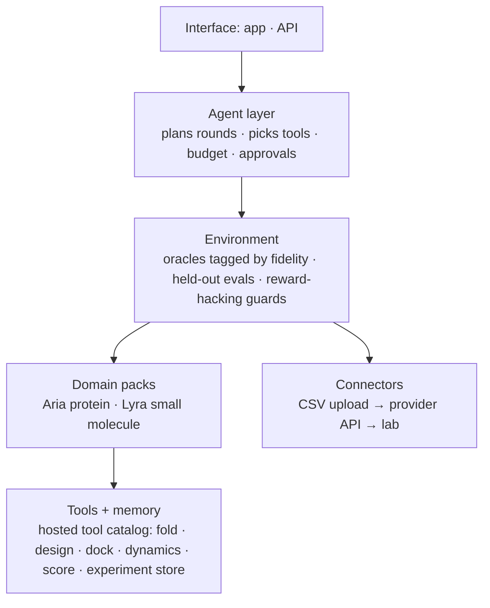
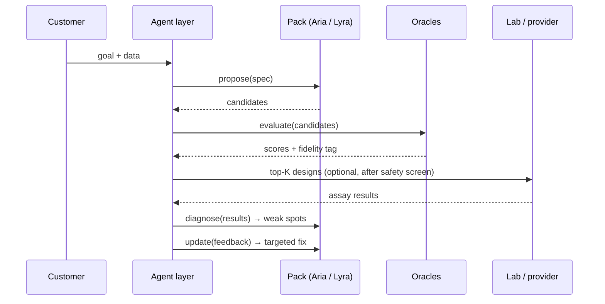

# SynqLab — Design Spec

_2026-10-23 · draft · build status is [TODO confirm] unless stated · long-form backlog: [`archive/product/architecture.md`](archive/product/architecture.md)_

**Naming (2026-10-24):** SynqLab is the platform. Aria and Lyra are domain agents (the "packs" below). Direct tools are a hosted catalog, not built by us. See [`platform.md`](platform.md).

**Goal:** a framework that turns a team's data into a private model for their target, finds where it falls short, and fixes it — with every step traceable.

---

## Layers



---

## The loop



---

## Pack contract

Every domain pack implements the same four calls. Adding a domain = writing a pack, not rebuilding the system.

```python
propose(spec)        -> candidates
evaluate(candidates) -> scores          # each tagged: in-silico | calibrated | wet-lab
diagnose(results)    -> weak_spots      # today: expert-guided. Goal: automatic
update(feedback)     -> new_version     # SFT / preference tuning, versioned
```

| Pack | Status |
|---|---|
| Aria (protein / peptide) | Shown in-silico on 4 families (founder-reported) |
| Lyra (small molecule) | Planned. Old docs call this agent "Phoenix" — [TODO confirm name + base: SmileyLlama vs SyntheMol-RL, check license] |

---

## Provider connector

| Phase | What | Needs |
|---|---|---|
| 0 | Customer uploads results (CSV) | Nothing external |
| 1 | One provider via API (e.g. Adaptyv) | A signed quote, one reproducible assay |
| 2 | Several providers + credits | Proven demand |

Result record: `design_id · sequence · assay · value · replicate · date · provider`.
Every outbound design passes a safety screen first.

---

## Traceability

- Every artifact (dataset, model, candidate, result) has a content hash and a `parents` list.
- Append-only log: who/what ran, inputs, outputs, model + tool versions, approver.
- Used for: reproducing results, tracing why a model failed (feeds `diagnose`), and biosecurity audit.
- Drop for now: 21 CFR Part 11, inventorship reports.

## Isolation + ownership

- Per-customer data and models. Customer hosts and owns the weights.
- Shipped runtime includes sequence screening and logging.
- No cross-customer sharing of weights or data. [TODO decide: share aggregated *process* knowledge (what worked for which target type), opt-in?]
- Owning weights means we can't fully prevent misuse. Mitigation: vet customers, license terms, screening in the runtime, hosted option.

---

## Experiment gates

| # | Test | Pass | If fail |
|---|---|---|---|
| G1 | Loop vs static model, random, diversity, standard active learning — frozen data, homology-aware splits | Loop wins at equal oracle budget | Rethink the loop |
| G2 | Agent vs same loop without agent (and vs expert route) | Agent wins on hit rate per dollar or operator time | **Cut the agent from the pitch** |
| G3 | Expert interventions per round | Rate falls across rounds and targets | Say "expert-guided", drop "self-improving" |
| G4 | Prospective wet-lab round, blind, models frozen | Beats baselines in the same assay | No wet-lab claim |
| G5 | Performance vs number of customer labels (0/10/25/50/100) | Curve rises quickly | "Adapts with ~100 labels" unsupported |

Not covered: novel targets with no natural sequences to anchor on — test with a calibrated-oracle preference source (MDMI-style) [TODO].

---

## Open decisions

1. Lyra vs "Phoenix"; SmileyLlama vs SyntheMol-RL; licenses.
2. Edison / FutureHouse agents: in or out?
3. What customers pay for repeatedly (hypothesis: the improvement loop).
4. Cross-customer process-knowledge sharing: yes or no.
5. Biosecurity statement and who reviews it.
