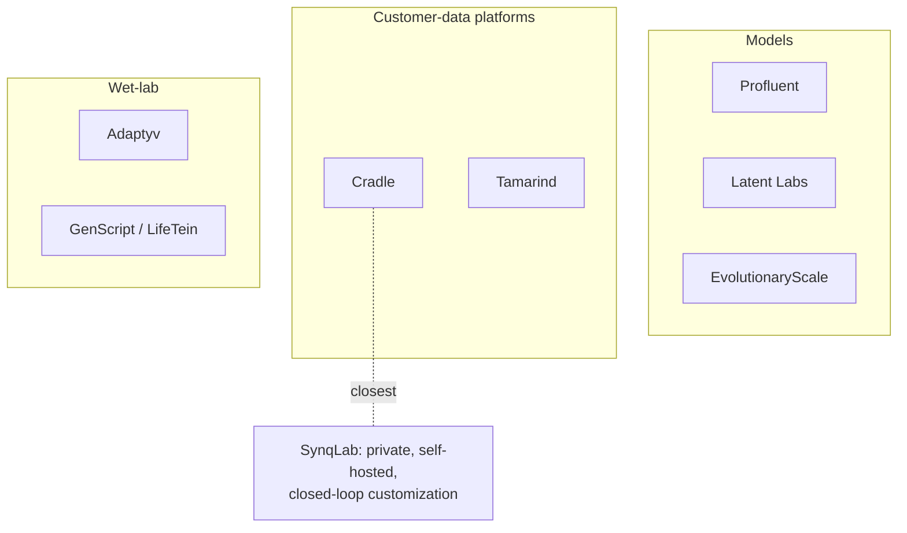

# Market Research

_2026-10-23 · mostly news/aggregator sources · verify before putting in a deck_

## Landscape

| Company | Notes | Funding |
|---|---|---|
| [Cradle](https://www.cradle.bio/pricing) | Annual license by active projects. Private per-customer models; customer owns generated sequences ([licensing](https://www.cradle.bio/licensing)). SOC-2 claimed. Novo Nordisk, Ginkgo | [$73M Series B](https://www.synbiobeta.com/read/ai-powered-protein-engineering-heightened-by-cradle-bios-73m-series-b), >$100M total |
| Profluent | Protein foundation models | [$106M](https://www.bioxconomy.com/investment/profluent-raises-106m-to-advance-ai-driven-protein-design-platform), ~$150M total |
| Latent Labs | Latent-X binder model + API; Latent-X2 antibodies; Latent-Y text-prompt antibody agent (Mar 2026) | [$50M](https://techcrunch.com/2025/02/12/founded-by-deepmind-alumnus-latent-labs-launches-with-50m-to-make-biology-programmable) |
| Adaptyv | Wet-lab service + API | [$8M seed](https://www.biopole.ch/adaptyv-leaves-the-beta-phase-following-its-8m-seed-round/); [$40M Series A reported](https://european-biotechnology.com/?p=21607), unverified |
| [Tamarind](https://www.extruct.ai/hub/tamarind-bio-funding/) | YC W24; no round found | unknown |
| EvolutionaryScale | Protein foundation models | not found |

## Key signal: Anthropic autonomous protein design study (Aug 2026)

Source: [news summary](https://oncodaily.com/technology/anthropic570775). Read the original too.

- AI models ran nearly the whole campaign using public tools. Adaptyv ran SPR assays.
- 1,320 designs → 354 binders. Hit rate 22.6–35.1% vs a 10–15% field norm Anthropic cites.
- **Open-loop:** models never saw assay results.

Meaning for us: validates agent + provider loops; commoditizes thin "agent + public tools"; leaves **closed-loop learning on customer data** open.

## Market size

| Source | Estimate |
|---|---|
| [MarketsandMarkets](https://www.marketsandmarkets.com/Market-Reports/ai-in-protein-engineering-market-27766714.html) | ~$1.4B (2026) → $3.8B (2031) |
| [Mordor](https://www.mordorintelligence.com/industry-reports/ai-in-protein-engineering-market) | ~$1.5B (2025) → $4.75B (2031) |
| [Spherical Insights](https://www.sphericalinsights.com/reports/ai-protein-design-market) | ~$1.45B (2025), broader scope |

~21% CAGR across sources. Software share disagrees ~2x between them. **No bottom-up team count found** — build from interviews + a Cradle-style price quote [TODO]. Drop the old $5B / $9.5B figures.

## Provider cost (one round)

| Provider | Price | Turnaround | Source |
|---|---|---|---|
| Adaptyv | ~$149/protein (list) | ~3 weeks | [secondary](https://aiwiki.ai/wiki/adaptyv_bio/raw), confirm |
| LifeTein | ~$2/residue (peptide synthesis) | 2–3 wks | [site](https://lifetein.com/peptide-synthesis-services.html) |
| GenScript | ~$3.20/residue | from 5 days | [site](https://www.genscript.com/peptide-services.html) |

50-design round at Adaptyv ≈ **$7.5K, ~3 weeks**. No binding-assay prices found for GenScript/LifeTein — request quotes.

## Funding comparables

- **YC:** [$500K](https://www.roundfunded.com/blogs/yc-standard-deal-equity-explained-2026) ($125K for 7% + $375K uncapped MFN SAFE), secondary sources.
- **Speedrun:** ["up to $1M"](https://a16z.com/speedrun/); split reported inconsistently.
- **2026 seeds:** [10x Science $4.8M](https://www.hpcwire.com/aiwire/tag/ai-for-drug-discovery/), [Accipiter Bio $10.5M ext.](https://dealroom.co/news/142484-accipiter-bio-adds-10-5m-seed-extension-to-fast-track-ai-designed-drugs/), outlier [Proxima $80M](https://www.startuphub.ai/ai-news/funding-round/2026/proxima-80m-funding-fuels-ai-drug-design-for-proximity-therapeutics.md).
- The current ask is the accelerator deals (YC $500K, Speedrun up to $1M). The seed comparables above matter for the round after.

## So what

1. Cradle overlaps the "private per-customer model" pitch. Differentiate on customer-hosted weights, natural-language specs, the diagnosis loop (hypotheses).
2. Provider loop is feasible (~$7.5K/round).
3. The ask is the accelerator deal, not a seed round.
