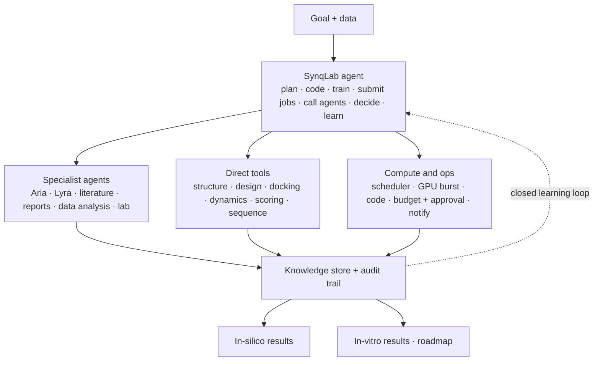

# SynqLab — The Platform

_2026-10-24 · draft · source: platform architecture doc (2026-05-24) and the website diagram in `website/src/components/PlatformFlow.jsx`_

## What it is

**SynqLab is the agentic platform for molecular design.** A workspace where a team, its agents, its data and its records stay together, from the first idea toward a regulatory filing. Agents do the work. The platform runs everything around them: projects, roles, approvals, documents, memory, compute and an audit trail.

Public taglines (founder decision, 2026-10-24): SynqLab **"An AI lab for biology."** Aria **"AI that designs proteins."** (the earlier "operating system for molecular design" was dropped: too narrow and too jargon-heavy). Keep site language plain. Wording for regulators: "built for traceability toward a filing". Never "FDA-ready" or "compliant".

| Product | What | Status |
| --- | --- | --- |
| **SynqLab** | The platform | Existing platform, to be integrated with the website |
| **Aria** | Protein agent. A customization framework (SFT + preference tuning) on public or private data. Customers host and own the models | Available. NeurIPS 2026 paper |
| **Lyra** | Small-molecule agent (working name) | In development. Trademark and Lyra-vs-Phoenix decision pending |

## Architecture

## Team workspace (what the platform is for)

- Organizations, projects, programs and roles.
- Documents and project memory: versioned, traceable, searchable.
- Approvals for spend and key steps. Notifications and handoffs, with a human in the loop.
- Append-only, signed audit log of every action: what ran, on which data, with which model version.

`[TODO]` Confirm which of these exist in the platform today. The website timeline (Day 0 → submission) is illustrative until then.

## Tools layer

Decision (2026-10-24): the direct tools are a **hosted catalog, not built by us**. Our value is the agent that picks and chains them, the customization of models on customer data, and the record. Showing tools by category on the site keeps this honest.

| Category | Engines shown on the site |
| --- | --- |
| Structure prediction | AlphaFold, Boltz, Chai-1, ESMFold |
| Generative design | RFdiffusion, ProteinMPNN, BoltzGen, BindCraft |
| Docking | DiffDock, AutoDock Vina, GNINA |
| Molecular dynamics | GROMACS |
| Scoring | pLDDT, ipTM, Rosetta |
| Sequence analysis | MMseqs2, InterPro, DeepTMHMM, SignalP, UniProt |

- AlphaFold, ESMFold, Boltz, Chai-1, Rosetta, MMseqs2, InterPro, DeepTMHMM and SignalP appear in our own code and papers. The design and docking engines and GROMACS come from the catalog of a hosted-tools provider (Tamarind Bio: web, API and MCP access, 300+ tools, SOC 2 — their claims, from their site).
- `[TODO]` Are we integrating a provider? If yes, which, and may we name it? Until then the site says "hosted, not built by us" and does not name them or quote their numbers.
- `[TODO]` Confirm each engine is actually callable from the platform before launch, or trim the list.

## Specialist agents on the site

Only **Aria** and **Lyra** are named. Literature, Reports, Data analysis and Lab agent are shown generically and marked Planned or Roadmap in the details panel. The old docs name Edison, Crow, Falcon, Finch and Phoenix. `[TODO]` decide whether to keep them (open question 12 in `STATUS.md`).

## On the website

- Aria workspace: models table with per-version performance, new-model wizard, replayed recorded rounds (see STATUS). Not on the public site (policy: nothing playable without login; videos only). In the product at Lab → Aria (`/lab/aria`, `AriaDemoPage.tsx`), recorded-results replay.
- `/aria` page: plain-language loop animation (`AriaLoop.jsx`: Ask, Propose, Check, Learn), a request-to-output example, and the results chart.
- `/platform` page: hero, the clickable animated diagram, the team-workspace timeline, principles.
- Diagram text and the node panel copy: `website/src/components/platformNodes.js`. Status (Available, In development, Planned, Roadmap) shows only in the side panel, not on the diagram.
- Open issue: the diagram lists engines (AlphaFold, RFdiffusion, DiffDock, GROMACS, ...) as available, but the product registry has only 7 live tools. Add Live/Planned per engine in the panel, or trim the list (STATUS item 17).
- Rule: nothing in the panel may describe behavior the platform does not have. Review the draft text against the real platform.
