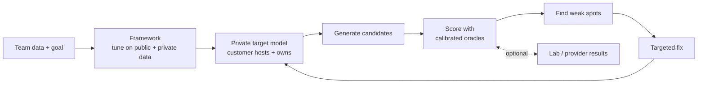
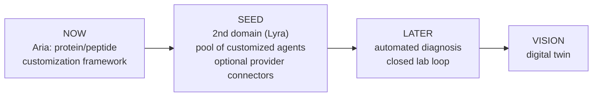

# SynqLab — Strategy

_Updated 2026-10-23 · working draft · facts marked [TODO] or "founder-reported" are unverified_

## One-liner

> **Self-improving AI models for biology.**
> SynqLab turns a team's own data into a private model for their target, finds where it falls short, and fixes it.

**Product map.** SynqLab is the agentic platform. Aria (proteins) and Lyra (small molecules, in development) are agents on it. The pitch below is about the self-improving customization framework that Aria is today and every future agent reuses. Details: [`platform.md`](platform.md).

---

## How it works

Today an expert (us) picks the weak spot and the fix. The goal is to automate that.

---

## Wedge → vision

| Stage | What | Proof needed to move on |
|---|---|---|
| Now | Customize a model for one target | A real target improves over rounds |
| Seed | More domains, agent pool, provider links | Agent beats active-learning baseline |
| Later | System finds + fixes its own weak spots | Expert interventions per round go down |
| Vision | Digital twin | Predicts wet-lab results prospectively |

---

## Who and what

- **Customer:** protein/peptide teams (biotech, pharma R&D, academic) with small labeled datasets.
- **Offer:** build a model from our base or yours. Customer hosts and owns the weights.
- **Pays for (hypothesis):** a subscription for the improvement loop — calibration, diagnosis, updates. Not compute, not weights.

---

## Evidence

| Claim | Status |
|---|---|
| Framework follows specs, improves under preference tuning | Shown in-silico, 4 protein families (founder-reported) |
| ~100 labels calibrate a binding oracle (MDMI, 4x more high-confidence binders vs RFdiffusion + PepMLM) | Wet-lab, one system, NeurIPS 2025 AI4D3 workshop |
| 113 labeled GFP11 sequences | In hand |
| Transfer to unseen families | Addressed, **unpublished** [TODO preprint] |
| Agent / orchestrator beats a plain loop | **Not shown** |
| Customers want private, owned models | **Hypothesis** — no interviews yet |

---

## Biggest risks

1. **No customer pull yet.** Collaborating labs give credibility, not demand.
2. **Cradle already sells private per-customer models.** See [market-research.md](market-research.md).
3. **Tuning is cheap.** The defensible part is closed-loop learning on customer data, not training.
4. **Agent layer may be theater** until an ablation says otherwise.
5. **Novel targets** have no natural sequences to anchor on.
6. **Biosecurity** vs customer-owned weights.

---

## Next 90 days

1. 5 customer interviews (ask about behavior, not opinions).
2. 2–3 provider quotes (Adaptyv, GenScript, LifeTein).
3. Benchmark + ablation vs strong baselines (incl. active learning).
4. One prospective wet-lab round on a real target.
5. Log every expert intervention. Track the rate.
6. Write the biosecurity statement.

---

## Pitch rules

- Broad vision, narrow proof.
- Say "expert-guided today, automated over time."
- No "digital twin" or "autonomous" claims in the headline.
- Never claim a venue, partner, or result we can't show.
