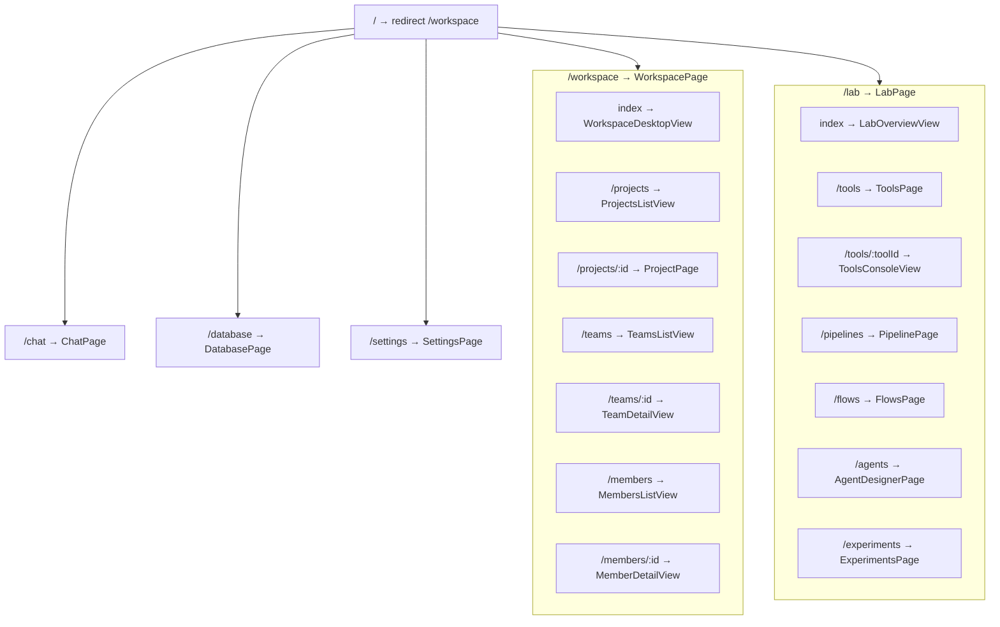
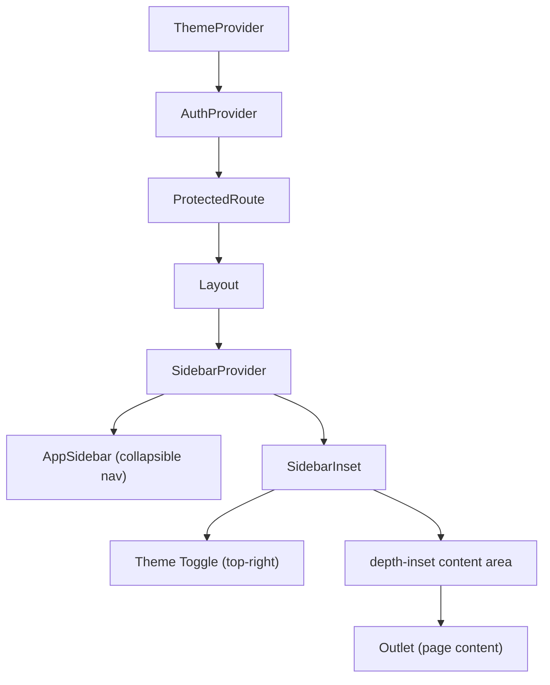
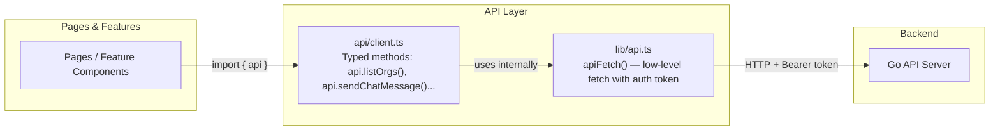
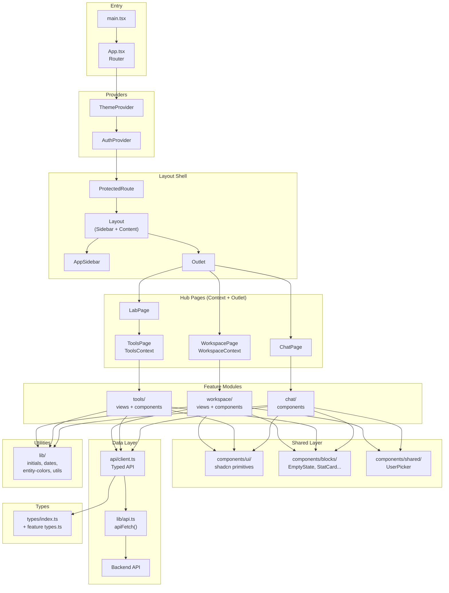

# SynqLab Frontend Architecture

> **Source of truth** for the SynqLab frontend codebase.
> Stack: React 18 · React Router 6 · TypeScript · Vite · shadcn/ui · Vanilla CSS

---

## Table of Contents

1. [Directory Structure](#directory-structure)
2. [Routing Map](#routing-map)
3. [Layout System](#layout-system)
4. [Component Taxonomy](#component-taxonomy)
5. [Feature Modules](#feature-modules)
6. [Data Flow & API Layer](#data-flow--api-layer)
7. [Type System](#type-system)
8. [Styling System](#styling-system)
9. [Canonical Utilities](#canonical-utilities)
10. [Architecture Diagram](#architecture-diagram)

---

## Directory Structure

```
src/
├── api/                    # Typed API client layer
│   └── client.ts           # Central typed HTTP client (all endpoints)
├── assets/                 # Static images (hero.png, icons)
├── components/             # Shared, reusable components
│   ├── ui/                 # shadcn/ui primitives (DO NOT hand-write)
│   ├── blocks/             # App-level reusable blocks (EmptyState, StatCard…)
│   ├── shared/             # Cross-feature shared components (UserPicker)
│   ├── layout/             # Layout shells (Layout, ModularPageLayout)
│   ├── auth/               # Auth components (LoginForm, ProtectedRoute)
│   ├── logs/               # LiveLogs viewer
│   ├── app-sidebar.tsx     # Global sidebar (collapsible, all nav)
│   ├── site-header.tsx     # Site header bar
│   ├── Logo.tsx            # Brand logo
│   └── ArchScene3D.tsx     # 3D scene for landing page
├── contexts/               # React contexts (global state)
│   ├── AuthContext.tsx      # Auth state, login/logout, token
│   └── ThemeContext.tsx     # Light/dark theme, system preference
├── features/               # Domain modules (vertical slices)
│   ├── chat/               # Chat feature
│   ├── lab/                # Lab hub (overview, sidebar)
│   ├── tools/              # Tool catalog, console, detail
│   ├── workspace/          # Workspace hub (orgs, teams, members)
│   ├── organization/       # Org tree, detail panes, modals
│   ├── projects/           # Project creation, sidebar
│   └── people/             # People sidebar
├── hooks/                  # Global hooks
│   └── use-mobile.tsx      # Mobile breakpoint detection
├── lib/                    # Canonical utility functions
│   ├── api.ts              # Low-level apiFetch + token management
│   ├── dates.ts            # Date formatting (relativeTime, formatDate…)
│   ├── initials.ts         # Name → initials
│   ├── entity-colors.ts    # Deterministic entity color generation
│   ├── hashPalette.ts      # Hash-based color palette
│   ├── icons.ts            # Icon mapping helpers
│   ├── roleStyle.ts        # Role badge styling
│   └── utils.ts            # cn() classname merger
├── pages/                  # Route-level page components
├── styles/                 # Design tokens & themes
│   ├── themes.css          # Light/dark HSL variables
│   └── tokens.css          # Spacing, radius, shadow tokens
├── types/                  # Global shared types
│   └── index.ts            # Tool, Category, Job, Pipeline types
├── App.tsx                 # Root router
├── main.tsx                # Entry point
├── index.css               # Global CSS (animations, depth effects)
└── App.css                 # App-level base styles
```

---

## Routing Map

### Public Routes (no auth)

| Path | Page | Description |
|------|------|-------------|
| `/landing` | `LandingPage` | Marketing landing page |
| `/blog` | `BlogPage` | Blog/news page |
| `/login` | `LoginPage` | Login form |
| `/signup` | `SignupPage` | Registration form |
| `/invite/:token` | `InvitePage` | Org invitation accept flow |

> On `synqlab.ai` root domain, only `/`, `/landing`, and `/blog` are available.

### Authenticated Routes (under `Layout`)



### Backward-Compat Redirects

| Legacy Path | Redirects To |
|---|---|
| `/projects` | `/workspace/projects` |
| `/organization` | `/workspace/teams` |
| `/people` | `/workspace/members` |
| `/tools` | `/lab/tools` |
| `/pipeline` | `/lab/pipelines` |
| `/designer` | `/lab/agents` |
| `/flows` | `/lab/flows` |
| `/experiments` | `/lab/experiments` |
| `/health` | `/lab/tools` |
| `/workspace/invites` | `/workspace/members` |
| `/workspace/settings` | `/workspace` |

---

## Layout System



| Component | File | Role |
|-----------|------|------|
| **Layout** | `components/layout/Layout.tsx` | Root shell — sidebar + content + theme toggle |
| **ModularPageLayout** | `components/layout/ModularPageLayout.tsx` | Two-column layout (sidebar + content) for Chat, Projects |
| **PageSidebar** | `components/layout/PageSidebar.tsx` | Left sidebar panel wrapper |
| **SidebarCollapsibleGroup** | `components/layout/SidebarCollapsibleGroup.tsx` | Collapsible sidebar section |
| **AppSidebar** | `components/app-sidebar.tsx` | Global navigation sidebar (all workspace + lab links) |

### Hub Pages (Outlet Pattern)

These pages act as **context providers + shells** — child views render via `<Outlet />`:

| Hub Page | Context Provided | Child Views |
|----------|-----------------|-------------|
| `WorkspacePage` | `WorkspaceContext` (orgs, teams, members, projects) | Desktop, Projects, Teams, Members, Settings |
| `LabPage` | None (pass-through shell) | Overview, Tools, Pipelines, Flows, Agents, Experiments |
| `ToolsPage` | `ToolsContext` (tools, categories, health, compute) | Console, Grid, Detail |

---

## Component Taxonomy

### 1. shadcn/ui Primitives — `components/ui/`

> **Rule:** Always use these. Never hand-write dropdowns, dialogs, selects, etc.

| Component | File | Used By |
|-----------|------|---------|
| AlertDialog | `alert-dialog.tsx` | Destructive confirmations |
| Alert | `alert.tsx` | Inline warnings/errors |
| Avatar | `avatar.tsx` | User/org avatars |
| Badge | `Badge.tsx` | Status labels, tags |
| Breadcrumb | `breadcrumb.tsx` | Navigation trails |
| Button | `Button.tsx` | All buttons (with loading state) |
| Card | `Card.tsx` | Content containers |
| Checkbox | `checkbox.tsx` | Multi-select forms |
| Collapsible | `collapsible.tsx` | Expandable sections |
| Command | `command.tsx` | Search/combobox (cmdk) |
| Dialog | `dialog.tsx` | Modal dialogs |
| DropdownMenu | `dropdown-menu.tsx` | Context menus, action menus |
| EntityCard | `entity-card.tsx` | **Custom** — rich card with badges, actions, overlays |
| Form | `form.tsx` | react-hook-form integration |
| Input | `Input.tsx` | Text inputs (with icon slots) |
| Label | `label.tsx` | Form labels |
| Popover | `popover.tsx` | Floating panels |
| Progress | `progress.tsx` | Progress bars |
| RadioGroup | `radio-group.tsx` | Single-select options |
| ScrollArea | `scroll-area.tsx` | Custom scrollbars |
| Select | `select.tsx` | Dropdown selects |
| Separator | `separator.tsx` | Visual dividers |
| Sheet | `sheet.tsx` | Slide-out panels |
| Sidebar | `sidebar.tsx` | Full sidebar system (Provider, Menu, Items) |
| Skeleton | `skeleton.tsx` | Loading placeholders |
| Sonner | `sonner.tsx` | Toast notifications |
| Switch | `switch.tsx` | Toggle switches |
| Table | `table.tsx` | Data tables |
| Tabs | `tabs.tsx` | Tab navigation |
| Textarea | `textarea.tsx` | Multi-line text |
| Toggle | `Toggle.tsx` | Toggle buttons |
| ToggleGroup | `toggle-group.tsx` | Grouped toggles |
| Tooltip | `tooltip.tsx` | Hover tooltips |

### 2. Block Components — `components/blocks/`

Reusable, app-level building blocks shared across all features:

| Component | Purpose |
|-----------|---------|
| `EmptyState` | Icon + title + description + action for empty lists |
| `ErrorState` | Error display with retry action |
| `LoadingState` | Centered spinner |
| `ListSkeleton` | Animated list placeholder |
| `PageHeader` | Page title + description + actions bar |
| `PageShell` | Full page wrapper with header + content area |
| `InitialsAvatar` | Colored circle with name initials |
| `LiveIndicator` | Pulsing status dot |
| `RoleChip` | Colored role badge (admin/member/viewer) |
| `StatCard` | Metric card with label + value |
| `StatPill` | Compact inline stat |
| `TagChip` | Tag label chip |

### 3. Shared Components — `components/shared/`

| Component | Purpose | Used By |
|-----------|---------|---------|
| `UserPicker` | Org-scoped user search with avatar list | ChatArea, NewChatDialog, ProjectPage, MembersTab |

### 4. Auth Components — `components/auth/`

| Component | Purpose |
|-----------|---------|
| `LoginForm` | Email/password + Google OAuth login |
| `SignupForm` | Registration form |
| `ProtectedRoute` | Auth gate — redirects to `/login` if unauthenticated |

### 5. Other Top-Level Components

| Component | Purpose |
|-----------|---------|
| `AppSidebar` | Global navigation — workspace + lab sections, org switcher |
| `SiteHeader` | Top header bar with breadcrumbs |
| `Logo` | SVG brand logo |
| `ArchScene3D` | Three.js 3D visualization for landing page |
| `LiveLogs` | Real-time log streaming component |

---

## Feature Modules

Each feature follows this structure:

```
features/<name>/
├── types.ts          # Domain types (interfaces)
├── helpers.ts        # Pure utility functions (re-export from lib/)
├── hooks/            # React hooks (data fetching, state)
│   └── use<Name>Data.ts
├── components/       # Feature-specific UI components
│   ├── <Name>Sidebar.tsx
│   └── ...
└── views/            # Route-level views (rendered via Outlet)
    └── <Name>View.tsx
```

---

### `features/workspace/`

The org management hub — manages organizations, teams, members, projects.

| Layer | Files | Purpose |
|-------|-------|---------|
| **Hook** | `useWorkspaceData.tsx` | Fetches orgs, members, teams, projects; provides CRUD operations |
| **Views** | `WorkspaceDesktopView` | Overview dashboard with stats, org cards |
| | `ProjectsListView` | Projects grid (delegates to `ProjectsTab`) |
| | `TeamsListView` | Teams grid (delegates to `TeamsTab`) |
| | `MembersListView` | Members list (delegates to `MembersTab`) |
| | `InvitesListView` | Invites list (delegates to `InvitesTab`) |
| | `TeamDetailView` | Single team detail page |
| | `MemberDetailView` | Single member detail page |
| | `OrgSettingsView` | Org settings (name, avatar, danger zone) |
| **Components** | `WorkspaceSidebar` | Page-level sidebar navigation |
| | `WorkspaceModals` | Shared modals (new org, new team, delete confirm) |
| | `ProjectsTab` | Projects entity-card grid with search |
| | `TeamsTab` | Teams entity-card grid |
| | `MembersTab` | Members list with role editing |
| | `InvitesTab` | Invite management |
| | `TeamGraph` | Interactive team relationship visualization |

---

### `features/organization/`

The org tree — hierarchical org/team/member management with detail panes.

| Layer | Files | Purpose |
|-------|-------|---------|
| **Hook** | `useOrgData.tsx` | Full org data fetching + CRUD (orgs, members, teams, invites) |
| **Types** | `types.ts` | **Canonical** `Org`, `Member`, `Invite`, `Team`, `TeamMember` |
| **Components** | `OrgSidebar` | Tree sidebar (orgs → teams → members) |
| | `OrgTreeNode` | Recursive tree node with expand/collapse |
| | `OrgDetail` | Org detail pane |
| | `OrgDetailPane` | Org settings detail |
| | `OrgModals` | New org, rename, delete, invite modals |
| | `OrgDropdown` | Org selector dropdown |
| | `TeamDetail` | Team detail with members |
| | `TeamsFolderDetail` | Teams list folder view |
| | `MemberDetail` | Member detail card |
| | `PeopleFolderDetail` | People list folder view |
| | `InvitesFolderDetail` | Invites folder view |
| | `shared.tsx` | Shared sub-components (badges, role selectors) |

---

### `features/tools/`

The scientific tool catalog — browse, run, and inspect ML/bio tools.

| Layer | Files | Purpose |
|-------|-------|---------|
| **Hook** | `useToolsData.ts` | Fetches tools, categories, health status, compute info |
| **Views** | `ToolsConsoleView` | Split-pane: tool selector + ToolDetail runner |
| | `ToolsGridView` | Card grid of all tools with search/filter |
| | `ToolDetailView` | Standalone tool detail page |
| **Components** | `ToolDetail` | Full tool detail — description, inputs form, run, outputs |
| | `ToolCombobox` | shadcn Command-based tool search/select |
| | `ToolsSidebar` | Category sidebar for tool filtering |
| | `OutputFields` | Renders tool output fields (text, PDB, files) |
| | `PdbViewer` | 3D protein structure viewer (3Dmol.js) |
| | `ResourceCell` | GPU/RAM resource indicator |
| | `LinkIcons` | External link icons (GitHub, paper, HuggingFace) |

---

### `features/chat/`

Real-time messaging — AI assistant + DM + group + team chats.

| Layer | Files | Purpose |
|-------|-------|---------|
| **Types** | `types.ts` | `Session`, `Message`, `Participant`, `ChatOrg` (→ alias for `Org`) |
| **Components** | `ChatSidebar` | Session list with search, org filter, unread badges |
| | `ChatArea` | Message list + input composer + participant panel |
| | `NewChatDialog` | Create session wizard (AI/DM/Group/Team) |
| | `MessageBubble` | Single message with avatar, markdown, timestamps |
| | `ToolCallCard` | Inline tool-call result display |

---

### `features/lab/`

The science hub shell — overview dashboard and sidebar.

| Layer | Files | Purpose |
|-------|-------|---------|
| **Views** | `LabOverviewView` | Dashboard with stat cards linking to tools/pipelines/experiments |
| **Components** | `LabSidebar` | Lab section sidebar navigation |

---

### `features/projects/`

Project creation and sidebar navigation.

| Layer | Files | Purpose |
|-------|-------|---------|
| **Types** | `types.ts` | `Project`, `Org`, `Team` (re-exports from organization) |
| **Components** | `NewProjectModal` | Create project dialog (org + team + name + visibility) |
| | `ProjectsSidebar` | Project list sidebar with search and status filters |

---

### `features/people/`

People directory sidebar.

| Layer | Files | Purpose |
|-------|-------|---------|
| **Types** | `types.ts` | `Person` type with profile fields |
| **Components** | `PeopleSidebar` | Org-scoped people list with search |

---

## Data Flow & API Layer



### `api/client.ts` — Typed API Client

The **single source of truth** for all API calls. Organized by domain:

| Section | Methods | Count |
|---------|---------|:-----:|
| Tools / Lab | `getTools`, `getAllTools`, `getCategories`, `runTool`, `runPipeline`, `getJob`, `getExperiments`… | 11 |
| Database | `dbStatus`, `dbExperiments`, `dbToolRuns`, `dbArtifacts`, `dbTags` | 5 |
| Organizations | `listOrgs`, `createOrg`, `renameOrg`, `deleteOrg`, `uploadOrgAvatar`… | 5 |
| Org Members | `listOrgMembers`, `updateMemberRole`, `removeMember` | 3 |
| Org Invites | `listOrgInvites`, `createOrgInvite`, `deleteOrgInvite`, `previewInvite`, `acceptInvite`… | 7 |
| Teams | `listTeams`, `createTeam`, `updateTeam`, `deleteTeam`, `uploadTeamAvatar`, `listTeamMembers`… | 9 |
| Projects | `listProjects`, `createProject`, `getProject`, `updateProject`, `deleteProject`, `listProjectMembers`… | 9 |
| Chat | `listChatSessions`, `createChatSession`, `sendChatMessage`, `listChatParticipants`… | 9 |
| People | `searchPeople` | 1 |

**Shared helpers:** `get<T>()`, `post<T>()`, `patch<T>()`, `del()` — all go through `apiFetch()`.

### `lib/api.ts` — Low-Level Fetch

- Wraps `fetch()` with auth token injection (`Bearer` header)
- Exports `apiFetch()`, `ApiError`, `setApiAuthToken()`
- Only used directly for: auth bootstrap, binary downloads, AbortController flows

### When to use what

| Scenario | Use |
|----------|-----|
| Standard CRUD operations | `import { api } from '@/api/client'` |
| Auth login/logout | `import { apiFetch } from '@/lib/api'` |
| Binary file download | `import { apiFetch } from '@/lib/api'` |
| AbortController needed | `import { apiFetch } from '@/lib/api'` |

---

## Type System

### Global Types — `types/index.ts`

Lab/science domain types used by the API client and tool features:

`Tool`, `Category`, `HealthMap`, `ComputeInfo`, `JobResult`, `PipelineResult`, `DbTableResponse`, `DbExperiment`, `DbToolRun`, `DbArtifact`, `DbTag`

### Feature Types — Canonical Sources

| Type | Canonical Source | Re-exported By |
|------|-----------------|----------------|
| `Org` | `features/organization/types.ts` | `projects/types.ts`, `workspace/types.ts`, `chat/types.ts` (as `ChatOrg`) |
| `Member` | `features/organization/types.ts` | `api/client.ts` |
| `Invite` | `features/organization/types.ts` | `api/client.ts` |
| `Team` | `features/organization/types.ts` | `projects/types.ts` |
| `TeamMember` | `features/organization/types.ts` | `api/client.ts` |
| `Project` | `features/projects/types.ts` | `api/client.ts` |
| `Session` | `features/chat/types.ts` | `api/client.ts` |
| `Message` | `features/chat/types.ts` | `api/client.ts` |
| `Participant` | `features/chat/types.ts` | `api/client.ts` |

> **Rule:** Never define inline interfaces for domain entities. Import from canonical sources.

---

## Styling System

### CSS Architecture

```
index.css          → Global resets, animations, depth effects, content-glow
App.css            → App-level base styles
styles/themes.css  → Light/dark mode HSL color variables
styles/tokens.css  → Spacing, radius, shadow, typography tokens
```

### Theme System

- **Provider:** `ThemeContext` — supports `light`, `dark`, `system`
- **Toggle:** Sliding pill in `Layout.tsx` top-right corner
- **Variables:** HSL-based CSS custom properties (`--background`, `--foreground`, `--primary`, etc.)
- **Dark mode:** Applied via `.dark` class on `<html>`

### Key Design Tokens

| Token | Purpose |
|-------|---------|
| `--background` / `--foreground` | Base page colors |
| `--card` / `--card-foreground` | Card surface colors |
| `--primary` / `--primary-foreground` | Brand accent |
| `--muted` / `--muted-foreground` | Subdued text/backgrounds |
| `--border` | Border color |
| `--ring` | Focus ring color |
| `--radius` | Border radius base |
| `--surface` | Elevated surface color |

---

## Canonical Utilities

All shared utility functions live in `lib/`. Feature modules **re-export** from `lib/` — never redefine.

| Utility | File | Exports |
|---------|------|---------|
| **Initials** | `lib/initials.ts` | `initials(name)` → "JD" |
| **Dates** | `lib/dates.ts` | `relativeTime(iso)`, `formatDate(iso)`, `formatJoined(iso)`, `formatRelativeFuture(iso)` |
| **Entity Colors** | `lib/entity-colors.ts` | `entityColorHsl(id)` → deterministic HSL color |
| **Hash Palette** | `lib/hashPalette.ts` | `hashPalette(seed)` → color palette from string |
| **Icons** | `lib/icons.ts` | Tool/category → Lucide icon mapping |
| **Role Styling** | `lib/roleStyle.ts` | `roleStyle(role)` → CSS classes for role badges |
| **Utils** | `lib/utils.ts` | `cn()` — Tailwind/clsx class merger |

### Feature Re-export Pattern

```typescript
// features/chat/helpers.ts — re-exports, does NOT redefine
export { relativeTime } from '@/lib/dates'
export { initials } from '@/lib/initials'
// ... plus any chat-specific helpers
```

---

## Architecture Diagram



---

## Quick Reference: File Counts

| Directory | Files | Purpose |
|-----------|:-----:|---------|
| `pages/` | 16 | Route-level page components |
| `components/ui/` | 34 | shadcn/ui primitives |
| `components/blocks/` | 13 | Reusable app blocks |
| `components/layout/` | 4 | Layout shells |
| `components/auth/` | 3 | Auth components |
| `features/workspace/` | 17 | Workspace hub (hook + views + components) |
| `features/organization/` | 16 | Org tree management |
| `features/tools/` | 12 | Tool catalog & runner |
| `features/chat/` | 7 | Messaging system |
| `features/lab/` | 3 | Lab hub shell |
| `features/projects/` | 4 | Project management |
| `features/people/` | 3 | People directory |
| `lib/` | 8 | Canonical utilities |
| `contexts/` | 2 | Global React contexts |
| `api/` | 1 | Typed API client |
| `types/` | 1 | Global type definitions |
| **Total** | **~144** | |
